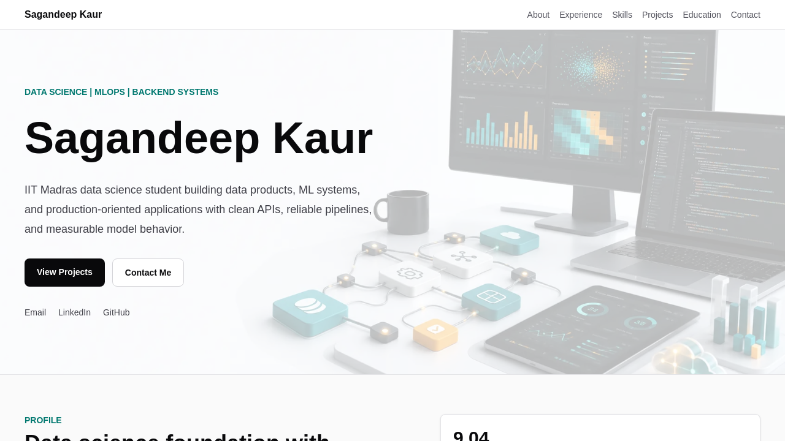
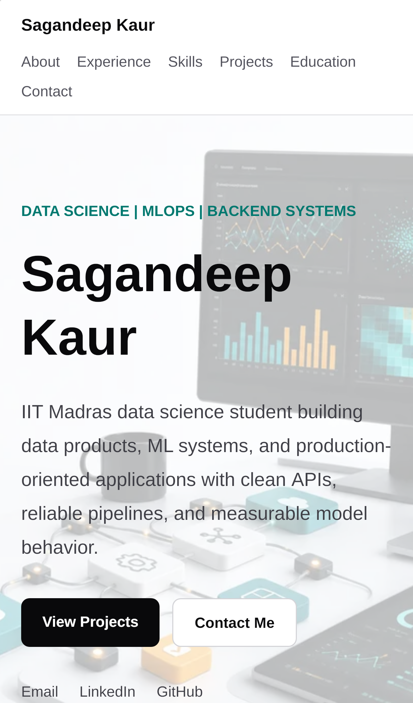

# Sagandeep Kaur — Portfolio

[](https://portfolio-kappa-swart-36.vercel.app)
[](https://nextjs.org/)
[](next-portfolio/tsconfig.json)

A responsive portfolio that presents my applied ML, backend, data, and MLOps work with direct repository links and evidence-based project summaries.






## Highlights

- Experience across NPTEL software engineering, NLP research, and teaching assistance.
- Selected projects in retrieval-augmented generation, computer vision, multilingual ML, backend systems, and MLOps.
- Responsive project and experience cards with accessible external links.
- No runtime API keys or database required.
- Reproducible local and Docker workflows.

## Live site

**<https://portfolio-kappa-swart-36.vercel.app>**

The production app lives in [`next-portfolio/`](next-portfolio). Vercel should use that directory as the project root.

## Run locally

Node.js 20.9 or newer is required.

```bash
cd next-portfolio
npm ci
npm run dev -- --hostname 0.0.0.0
```

Open <http://localhost:3000>.

For a production-mode check:

```bash
cd next-portfolio
npm ci
npm run build
npm run start -- --hostname 0.0.0.0
```

## Docker

Build from the repository root:

```bash
docker build -t sagandeep-portfolio .
docker run --rm --name sagandeep-portfolio -p 3000:3000 sagandeep-portfolio
```

Open <http://localhost:3000>.

## Architecture

```text
app/layout.tsx
  |
  +-- shared metadata and navigation
  |
  +-- app/page.tsx
  |     |-- hero and contact links
  |     |-- experience and skills
  |     |-- project evidence cards
  |     +-- education and contact
  |
  +-- app/about/page.tsx
        +-- short profile

Tailwind CSS 4 + app/globals.css
Static visual assets in public/
Next.js production server or Vercel
```

The site is intentionally data-light: experience, skills, and project entries are typed constants in `app/page.tsx`. This keeps deployment simple and makes public claims easy to review alongside their linked repositories.

## Quality checks

```bash
cd next-portfolio
npm run lint
npm run build
```

Manual checks should cover desktop and mobile layouts, anchor navigation, keyboard focus, external project links, and the `/about` route.

## Updating project content

1. Edit the `experiences` or `projects` arrays in `next-portfolio/app/page.tsx`.
2. Keep each claim supported by a linked repository, merged contribution, or other public evidence.
3. Distinguish personal prototypes from team, academic, internship, and production work.
4. Run lint and a production build before deployment.
5. Capture an updated homepage screenshot when the visual layout changes.

## Deployment

1. Import this GitHub repository into Vercel.
2. Set **Root Directory** to `next-portfolio`.
3. Keep the default Next.js build and output settings.
4. Deploy and smoke-test `/`, `/about`, and the project links.

## Limitations

- Content is maintained in source code rather than a CMS.
- The repository currently includes a hero visual, not a complete screenshot gallery.
- Project metrics reflect the context documented in their source repositories and may not be comparable across datasets.
- Some project links point to team or academic repositories; the cards summarize my documented contribution rather than sole ownership.
